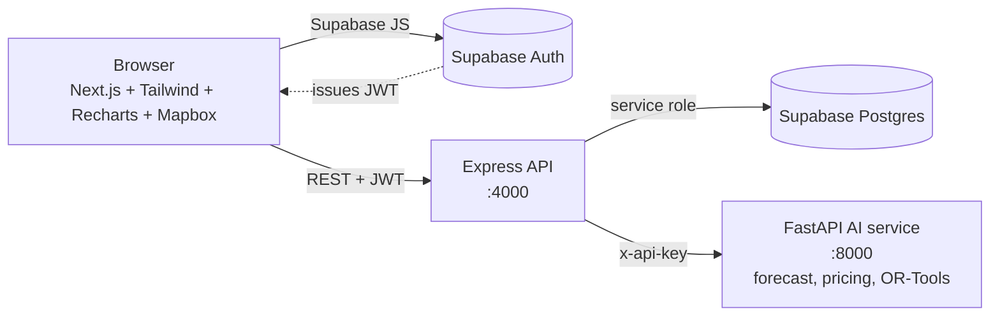

# KhetLink

A digital marketplace that connects **farmers and FPOs directly with households and bulk buyers**, pools deliveries onto shared trucks, and uses **AI for demand forecasting, fair pricing and route optimisation**.

The idea: farmers usually sell at the mandi for far less than shoppers pay at retail, and small orders are expensive to move. KhetLink lists produce at a fair farm-gate price between the two, then groups confirmed orders onto shared trucks so transport does not eat the savings.

> All demo data (prices, demand, orders) is synthetic and generated by `backend/scripts/seed.js`.

---

## What is in the box

| Requirement | Implementation |
|---|---|
| Frontend | Next.js 14 (App Router) + React 18 + Tailwind CSS, in `frontend/` |
| Backend | Node.js + Express REST API with Zod validation, in `backend/` |
| Database | PostgreSQL on Supabase, schema and row-level security in `database/schema.sql` |
| Auth | Supabase Auth (email + password). The API verifies the Supabase JWT on every request |
| AI services | Python + FastAPI in `ai-service/`: demand/price forecasting, price suggestion, route optimisation |
| Route optimisation | Google OR-Tools (capacitated vehicle routing with pickup-and-delivery pairs), with an automatic fallback heuristic |
| Maps | Mapbox GL JS when `NEXT_PUBLIC_MAPBOX_TOKEN` is set, otherwise a built-in SVG route canvas |
| Charts | Recharts |
| Dashboards | Farmer, FPO, household buyer, bulk buyer, driver and admin views |

### Features by role

- **Farmer**: list produce with an AI fair-price suggestion, manage stock, confirm and pack orders, see how much more they earn than at the mandi, read the market outlook, join an FPO.
- **FPO / cooperative**: everything a farmer can do for all member farmers, plus a fleet, route planning, shipment dispatch and pooled-logistics savings.
- **Household and bulk buyers**: browse and filter the marketplace (including nearest-first), compare against shop prices, order from several sellers in one cart, track orders, see savings.
- **Driver**: see assigned loads, follow the ordered pickup and drop stops on a map, start the trip and mark deliveries.
- **Admin**: platform-wide GMV, farmer premium, buyer savings, route savings and service health.

---

## Architecture



- The browser signs in with Supabase Auth and sends the resulting JWT to the Express API.
- The API verifies the token, loads the user's profile, enforces role-based access, and talks to Postgres with the service-role key.
- Row-level security policies are also defined in the schema as defence in depth (for example if you later query Supabase directly from the browser).
- The AI service is only called by the API (server to server, with a shared secret) and holds no state.

### Folder structure

```
khetlink/
├── database/schema.sql          Tables, RPC functions, RLS policies, views
├── backend/                     Express API
│   ├── src/config               env + Supabase client
│   ├── src/middleware           auth, validation, error handling
│   ├── src/routes               profile, products, orders, logistics, ai, analytics
│   ├── src/services             AI client, access rules
│   └── scripts/seed.js          Demo users, listings, market data, orders
├── ai-service/                  FastAPI service
│   ├── app/forecasting.py       Demand and price forecasts
│   ├── app/pricing.py           Fair-price suggestion
│   ├── app/routing.py           Vehicle routing (OR-Tools + fallback)
│   └── tests/                   Unit tests
├── frontend/                    Next.js app
│   ├── app/                     Pages (marketplace, cart, dashboard/*)
│   ├── components/              UI kit, charts, map, orders, logistics, product form
│   └── lib/                     API client, auth and cart context, formatting
├── docker-compose.yml           Runs the three services together
└── .env.example                 Variables for docker compose
```

---

## Quick start

### 1. Prerequisites

- Node.js 18.17 or newer (20 recommended)
- Python 3.10 or newer
- A free [Supabase](https://supabase.com) project
- Optional: a [Mapbox](https://mapbox.com) public token for street maps

### 2. Set up Supabase

1. Create a project at supabase.com.
2. Open **SQL Editor**, paste the contents of `database/schema.sql` and run it. It is idempotent, so you can run it again safely.
3. Open **Project Settings → API** and copy the **Project URL**, the **anon key** and the **service_role key**.
4. For quick demos, open **Authentication → Providers → Email** and switch off "Confirm email". If you leave it on, new sign-ups must click the emailed link first. The seeded demo accounts are already confirmed.

### 3. AI service (port 8000)

```bash
cd ai-service
python -m venv .venv
source .venv/bin/activate          # Windows: .venv\Scripts\activate
pip install -r requirements.txt
cp .env.example .env               # optional: set AI_SERVICE_KEY
uvicorn app.main:app --reload --port 8000
```

Check `http://localhost:8000/health`. The response includes `"ortools": true` when the OR-Tools solver is installed. Interactive API docs are at `http://localhost:8000/docs`.

### 4. Backend API (port 4000)

```bash
cd backend
npm install
cp .env.example .env               # fill in SUPABASE_URL and SUPABASE_SERVICE_ROLE_KEY
npm run seed                       # demo users, listings, 365 days of market data, orders
npm run dev
```

`AI_SERVICE_KEY` in `backend/.env` must match the one in `ai-service/.env` (or both can be left empty in local development). Check `http://localhost:4000/api/health`.

### 5. Frontend (port 3000)

```bash
cd frontend
npm install
cp .env.example .env.local         # Supabase URL + anon key, API URL, optional Mapbox token
npm run dev
```

Open `http://localhost:3000`.

### Or run everything with Docker

```bash
cp .env.example .env               # fill in the Supabase values
docker compose up --build
```

Run the seed once from your machine (`cd backend && npm run seed`) so the database has demo data.

---

## Demo accounts

Created by `npm run seed`. Password for all: **`Demo@12345`**

| Role | Email | Notes |
|---|---|---|
| Admin | `khetlink.admin@example.com` | Platform overview |
| FPO manager | `khetlink.fpo@example.com` | Has 3 vehicles and orders ready for routing |
| Farmer (FPO member) | `khetlink.farmer1@example.com` | Farmers 1 to 3 belong to the FPO |
| Farmer (independent) | `khetlink.farmer4@example.com` | Farmer 5 is also independent |
| Household buyer | `khetlink.consumer1@example.com` | Consumer 2 also available |
| Bulk buyer | `khetlink.buyer1@example.com` | Buyer 2 also available |
| Driver | `khetlink.driver1@example.com` | Driver 2 also available |

**Suggested walkthrough for a demo**

1. Sign in as the **FPO manager** → **Logistics → Plan routes**. Several confirmed and packed orders are waiting. Choose a start point and click **Optimise routes**. Look at the map, the per-truck stop lists and the distance, cost and CO₂ saved against one trip per order. Click **Dispatch**.
2. Sign in as **driver1** (Tata Ace Gold) or **driver2** (Bolero Pickup), depending on which vehicle the plan used → **My deliveries**. Start the trip and mark drops as delivered. The third vehicle (Eicher Pro) has no driver on purpose, so dispatching it shows the "assign a driver" warning.
3. Sign in as **consumer1** → **Marketplace**. Sort by "Nearest to me", open a product to see the price breakdown and the outlook, add items from two sellers, and check out. The cart splits into one order per seller.
4. Sign in as **farmer1** → **My listings → New listing**. Pick a crop and use the **Fair price assistant**. Then open **Orders** to confirm the new order and **Market outlook** for the forecast charts.
5. Sign in as **admin** for the platform-wide picture.

---

## The AI service

All three models are deliberately lightweight and explainable so that they run anywhere and their output can be justified in a viva.

### Demand and price forecasting (`POST /forecast/demand`, `/forecast/batch`)

- Ridge-regularised **harmonic regression** on `log(1 + y)`: a linear trend, weekly seasonality and (with at least a year of history) annual seasonality using Fourier terms.
- Produces a per-day forecast with an **80% prediction interval** that widens with the horizon.
- **Back-tested** on a held-out tail of the series; the response reports MAPE so the UI can show how far to trust it.
- With fewer than 21 days of history it falls back to a moving average and says so in `method`.
- `/forecast/batch` ranks all crops by an opportunity score (60% demand change, 40% price change) for the "what to list next" table.

### Fair price suggestion (`POST /pricing/suggest`)

Splits the gap between the mandi and retail price. The farmer's starting share is 45% of the gap, moved by the demand trend (up to +15 or −10 points), the quality grade (A/B/C) and an organic premium, then clamped between a floor above the mandi rate and a ceiling below retail. The response includes the recommended, minimum and maximum price, the implied farmer gain and buyer saving, a confidence level and a plain-language list of factors.

### Route optimisation (`POST /route/optimize`)

- Models the problem as a **capacitated vehicle routing problem with pickup-and-delivery pairs**: each order is picked up at the farm and dropped at the buyer by the same vehicle, with the pickup first, subject to vehicle capacity and a maximum route length.
- Solved with **OR-Tools** (parallel cheapest insertion for the first solution, guided local search to improve it), with per-vehicle cost per km.
- If OR-Tools is not installed, a greedy cheapest-insertion heuristic gives a valid plan and the response reports `method: "greedy-insertion"`.
- Distances are haversine distance multiplied by a circuity factor (1.35 by default for rural roads). Swap `build_distance_matrix` for a real routing API if you need road-exact numbers.
- **Baseline for savings**: one dedicated round trip per order (depot → pickup → drop → depot). Reported savings are distance, transport cost and estimated CO₂ against that baseline. Orders that cannot fit any vehicle are returned as `unassigned` with a reason instead of failing the plan.

Run the unit tests with `cd ai-service && python -m pytest -q`.

---

## API reference (Express, all under `/api`)

Auth: `Authorization: Bearer <Supabase access token>`. Public endpoints are marked.

| Method | Path | Who | Purpose |
|---|---|---|---|
| GET | `/health` | public | Database and AI service status |
| GET, PUT | `/profile/me` | any | Read or update own profile (role cannot be changed) |
| GET | `/profile/fpos`, `/profile/drivers` | any / FPO, admin | Lists for pickers |
| GET | `/products` | public | Browse with search, filters, sort (incl. nearest) and paging |
| GET | `/products/:id` | public | Product with seller and price comparison |
| GET | `/products/mine` | farmer, FPO, admin | Own listings |
| POST, PUT, DELETE | `/products[/:id]` | farmer, FPO (admin edit/delete) | Manage listings (ownership checked) |
| POST | `/orders` | signed in | Place an order. Atomic; splits per seller; checks stock |
| GET | `/orders?scope=buying\|selling\|delivery\|all` | by role | List orders |
| GET | `/orders/:id` | buyer, seller side, driver | Order detail |
| PATCH | `/orders/:id/status` | by role | Status changes follow a state machine |
| GET, POST, PUT, DELETE | `/logistics/vehicles` | FPO, admin | Fleet management |
| GET | `/logistics/pending-orders` | FPO, admin | Orders waiting for a truck |
| POST | `/logistics/optimize` | FPO, admin | Preview a route plan (nothing saved) |
| POST | `/logistics/dispatch` | FPO, admin | Turn a previewed plan into shipments |
| GET | `/logistics/shipments` | FPO, driver, admin | Shipments |
| PATCH | `/logistics/shipments/:id/status` | FPO, driver, admin | Start, complete or cancel |
| GET | `/ai/forecast` | signed in | Demand and price forecast for a crop |
| GET | `/ai/trending` | signed in | Crops ranked by momentum |
| GET | `/ai/price-suggestion` | signed in | Fair price for a crop |
| GET | `/analytics/seller`, `/buyer`, `/logistics`, `/admin` | by role | Dashboard numbers |

Order status flow: `placed → confirmed → packed → in_transit → delivered`, with `cancelled` possible from `placed` or `confirmed`. Cancelling returns stock to the listing.

---

## Design notes and known limitations

- **Authorisation** is enforced in Express (service-role client) and again by RLS policies in Postgres.
- **Orders** are placed through a `place_order` database function that locks the product rows, validates stock and minimum quantity, prevents buying your own listing, creates one order per seller and decrements stock in a single transaction.
- **Payments are stubbed.** Orders are cash or UPI on delivery and are marked paid when delivered. Plug a payment gateway into `orders.js` for a real deployment.
- **Route previews live in memory** for 15 minutes between "Optimise" and "Dispatch". Use Redis (or a table) if you run more than one API instance.
- **Maps draw straight segments** between stops. Distances and times come from the optimiser's road estimate, not from the drawn line.
- **Locations are entered by picking a place, using browser geolocation, or typing coordinates.** There is no address geocoding in this MVP.
- **No live vehicle tracking.** Trip status is updated by the driver.
- **Market data is synthetic.** In production, feed `market_data` from Agmarknet or a similar source; the forecasting code only needs a `crop, district, date, price, demand` history.
- The `NEXT_PUBLIC_*` variables end up in the browser bundle. Never put the service-role key in the frontend.

## Deployment sketch

- **Frontend**: Vercel (set the four `NEXT_PUBLIC_*` variables) or the provided Dockerfile.
- **Backend and AI service**: any container host (Render, Railway, Fly.io, Cloud Run) using the provided Dockerfiles. Set `CORS_ORIGIN` on the API to your frontend URL and use a real `AI_SERVICE_KEY`.
- **Database and Auth**: your Supabase project. Add your production URL under Authentication → URL Configuration.

## Troubleshooting

| Symptom | Fix |
|---|---|
| Yellow banner "Supabase is not configured" | Create `frontend/.env.local` from `.env.example` and restart `npm run dev` |
| "Cannot reach the KhetLink API" | Start the backend and check `NEXT_PUBLIC_API_URL` |
| Backend exits with "Missing environment variables" | Fill `backend/.env` |
| CORS error in the browser console | Add your frontend origin to `CORS_ORIGIN` in `backend/.env` |
| Forecast or route buttons return a 502/503 | Start the AI service, and check `AI_SERVICE_URL` and that both `AI_SERVICE_KEY` values match |
| Market outlook says "No market data" | Run `npm run seed` in `backend/` |
| Sign-up says to check your email | Turn off "Confirm email" in Supabase, or click the confirmation link |
| Map shows a schematic canvas instead of streets | Set `NEXT_PUBLIC_MAPBOX_TOKEN` (a public `pk.` token) and restart the frontend |
